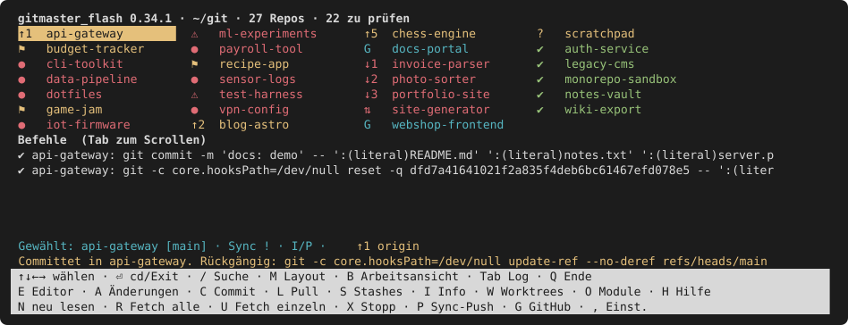
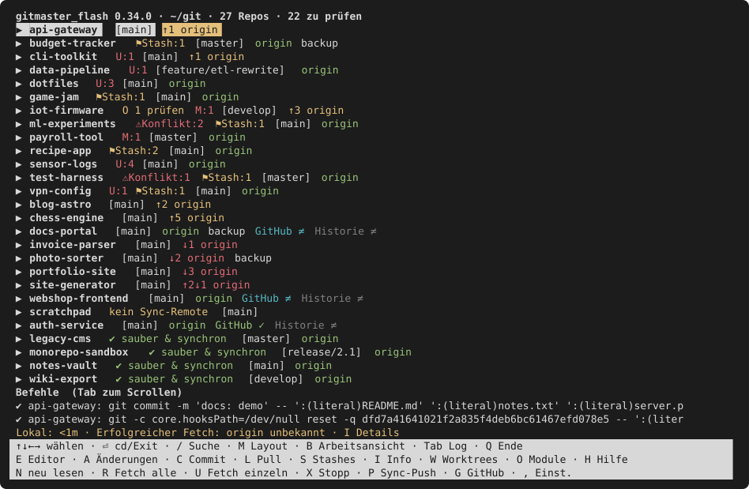

<p align="center">
  
</p>

<h1 align="center">Gitmaster Flash</h1>

**🌐 Sprache / Language:** [English](README.md) · [Deutsch](README.de.md)

Eine Terminal-Übersicht über die Git-Repositories unterhalb eines Ordners.
Die Liste zeigt lokale Änderungen, Stashes, Branches und den Remote-Status.
Das ausgewählte Repository lässt sich direkt prüfen und bearbeiten.
Gitmaster Flash verwendet die Python-Standardbibliothek und Git.



## Schnellstart

Vorausgesetzt sind Python 3.9+, Git 2.36+ und ein UTF-8-Terminal mit curses
unter macOS oder Linux. Die Demo läuft aus einem Checkout oder entpackten
Quellarchiv.

```sh
python3 gitmaster_flash.py --demo
```

Die Demo arbeitet mit temporären Beispiel-Repositories. Die Abbildung oben
stammt aus einem echten Demo-Lauf in einem Pseudoterminal.

Die Shell-Funktion aus dem Projektordner mit dem eigenen Benutzer installieren.

```sh
./install.sh          # macOS, Zsh
./install-linux.sh    # Linux, Bash, Fish oder Zsh
```

Danach in einer neuen Shell `gmf ~/projekte` oder `gmf` für den aktuellen
Ordner ausführen. Mit geladener Shell-Funktion beendet Enter die Übersicht und
wechselt in das ausgewählte Repository. Der Direktaufruf lautet
`python3 gitmaster_flash.py ~/projekte`. Die [Installationsanleitung](docs/installation.de.md)
beschreibt die Shell-Auswahl, vorhandene Registrierungen und die Startdateien.

## Repo-Übersicht

Repositories mit Handlungsbedarf stehen zuerst. Die Detailansicht zeigt
Dateizahlen, Branch und Remotes. Bei mehr als 20 Repositories startet eine
kompakte Spaltenansicht. `M` wechselt die Darstellung, `/` filtert nach
Repo-Pfad und `B` wählt eine Arbeitsansicht für lokale Änderungen, eingehende
Commits oder ausstehende Veröffentlichungen.



Mit `A` lassen sich Dateiänderungen im Arbeitsbaum, Index oder zusammen prüfen,
mit `C` ein Commit aus ausgewählten Pfaden vorbereiten. `S` gliedert Stashes
nach Dateien. `W` und `O` zeigen verwandte Worktrees und den Zustand der
Submodule. `R` aktualisiert den Remote-Status im Hintergrund. Die Liste bleibt
dabei bedienbar. Das Befehlsprotokoll hält die Git-Aktionen der Sitzung fest.
Der [Leitfaden zur Oberfläche](docs/interface.de.md) beschreibt die Ansichten.

Pull, Push und GitHub-Veröffentlichung verwenden Vorschauen oder Rückfragen,
die an den geprüften Repo-Zustand gebunden sind. Der [Leitfaden zu Übertragungen
und Schutzregeln](docs/security.de.md) erläutert die Bedingungen und die
Auswirkungen eines Fetchs.

## Bedienung

Die Fußzeile zeigt häufige Kürzel. `H` listet alle Aktionen auf. Buchstabentasten funktionieren in Groß- und Kleinschreibung.

| Taste | Aktion |
|---|---|
| ↑ / ↓ | Repo auswählen |
| → / ← | auf-/zuklappen (Dateien mit M/D/U/C, Stashes) |
| / | nach Repo-Pfad filtern |
| , | Einstellungen ansehen und bearbeiten |
| B | Arbeitsansicht wählen, unabhängig von der Pfadsuche |
| M | zwischen Kompakt- und Detailansicht umschalten |
| Tab | Fokus ins Befehlsprotokoll und zurück |
| ⏎ | beenden und in den Repo-Ordner wechseln (braucht den `gmf`-Wrapper) |
| E | Repo in einer konfigurierten App öffnen (eigene in `config.json` eintragen) |
| A | Änderungen Datei für Datei in einem rein lesenden Diff-Betrachter prüfen |
| C | Commit-Hilfe mit Auswahl-Vorschlägen |
| L | Pull-Remote wählen (oder erst alle fetchen), Vorschau und bestätigter Fast-Forward |
| P | aktuellen Branch sicher zum privaten Sync-Remote pushen |
| G | ausgehende GitHub-Commits und Dateien prüfen, dann mit J ⏎ bestätigen |
| H | Befehlsprotokoll dieser Sitzung und Git-Sicherheitsregeln anzeigen |
| W | Worktree-Familie samt registrierten Pfaden außerhalb der Scan-Wurzel ansehen |
| O | Submodul-Verweise, Inhalt und Initialisierung ansehen |
| I | Repo-, Remote- und Branch-Details, dort `T` Remote prüfen, `X` Remote entfernen (nicht rückgängig machbar) |
| S | Stashes nach Dateien ansehen oder einzeln/alle anwenden, poppen oder löschen |
| R | sichere Remotes im Hintergrund fetchen, während die Liste bedienbar bleibt |
| N | ausgewähltes Repo nur lokal neu lesen |
| U | ein Remote des ausgewählten Repos abrufen |
| X | Hintergrund-Fetch stoppen und fertige Ergebnisse behalten |
| Q | beenden |

## Kommandozeile

```sh
gmf ~/projekte --list --view changes
gmf ~/projekte --json > snapshot.json
gmf ~/projekte --diff buildbox:~/projekte
gmf --compare before.json after.json
```

Lokale Scans und Berichte können ohne curses-Oberfläche laufen. Ein
SSH-Vergleich überträgt dasselbe Skript an den anderen Rechner, der dafür
Python und Git braucht. Der [CLI-Leitfaden](docs/cli.de.md) beschreibt
Schalter, Exit-Codes, Datei-Diffs und Stashes.
Das [JSON-Format](docs/json-format.de.md) dokumentiert Snapshots und Befunde.

## Einstellungen und Entwicklung

- Die [Konfiguration](docs/configuration.de.md) führt alle Einstellungen auf und erklärt die Auswahl von Remotes und Apps.
- Die [Laufzeitprüfungen](docs/runtime-support.de.md) nennen geprüfte Python- und Git-Kombinationen und zeigen, wie sich die Prüfungen wiederholen lassen.
- [Architektur und Entwicklung](docs/architecture.de.md) beschreibt Tests, Demo-Bilder und Quellarchive.
- Das [Änderungsprotokoll](CHANGELOG.md) führt die Änderungen der Releases auf.

## Name

Eine Anspielung auf Grandmaster Flash und seine schnellen Wechsel zwischen Schallplatten.

## Lizenz

[WTFPL](LICENSE).
