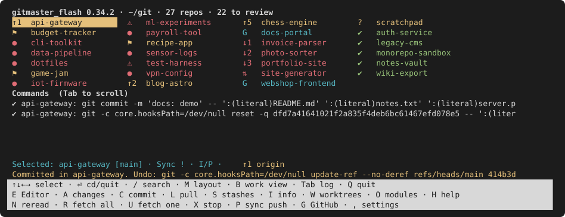
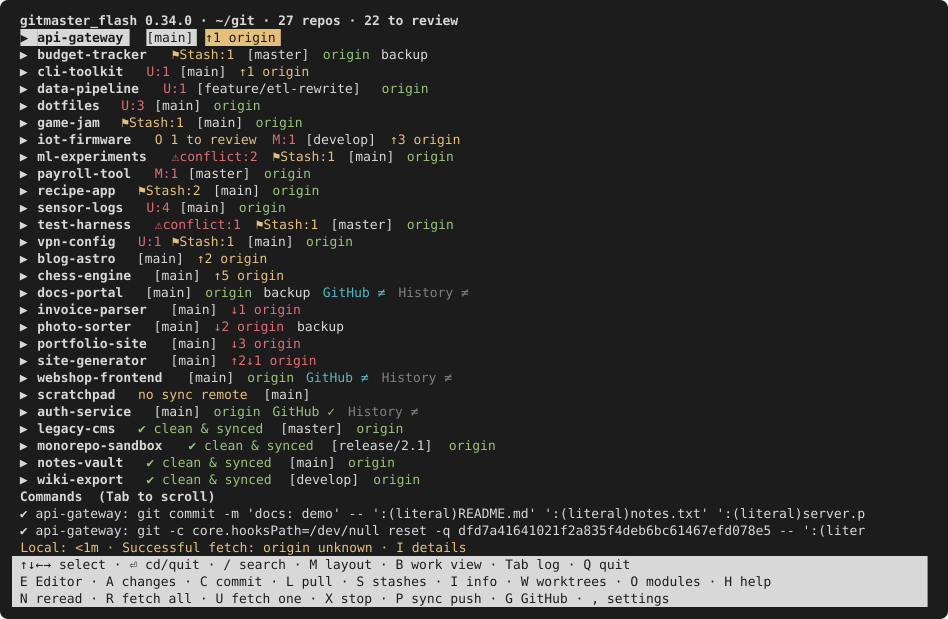

<p align="center">
  
</p>

<h1 align="center">Gitmaster Flash</h1>

**🌐 Sprache / Language:** [English](README.md) · [Deutsch](README.de.md)

A terminal overview of the Git repositories below a directory. Review local
changes, stashes, branches and remote status in one list, then inspect or act on
the selected repository. Gitmaster Flash uses the Python standard library and Git.



## Quick start

Requires Python 3.9+, Git 2.36+ and a UTF-8 terminal with curses on macOS or
Linux. From a checkout or an unpacked source archive, try the demo first.

```sh
python3 gitmaster_flash.py --demo
```

The demo uses temporary example repositories. The picture above comes from a
real demo session in a pseudo-terminal.

Install the shell function from the project directory as your own user.

```sh
./install.sh          # macOS, Zsh
./install-linux.sh    # Linux, Bash, Fish or Zsh
```

Open a new shell, then run `gmf ~/projects` or `gmf` for the current directory.
With the shell function loaded, Enter exits the overview and changes to the
selected repository. To run directly, use `python3 gitmaster_flash.py ~/projects`.
See the [installation guide](docs/installation.md) for shell selection,
existing registrations and the startup files involved.

## Repository overview

Repositories needing attention appear first. The detail layout shows file
counts, branch and remotes. Above 20 repositories the default is a compact
column layout. `M` changes layout, `/` filters by repository path and `B`
selects a work view such as local changes, incoming commits or pending
publication.



Use `A` to inspect a file in the working tree, index or combined diff and `C`
to prepare a commit from selected paths. `S` organizes stashes by file. `W`
and `O` show related worktrees and submodule state. `R` refreshes remote status
in the background while the list stays usable. The command log records the
Git actions taken in the session. The [interface guide](docs/interface.md)
shows how the views work.

Pull, push and GitHub publication use previews or confirmations bound to the
reviewed repository state. See the [transfer and safety guide](docs/security.md)
for their conditions and what a fetch updates.

## Keys

The footer shows common shortcuts. `H` lists all actions. Letter keys work in either case.

| Key | Action |
|---|---|
| ↑ / ↓ | select a repository |
| → / ← | expand / collapse (files with M/D/U/C, stashes) |
| / | filter by repository path |
| , | view or edit settings |
| B | choose a work view independently of path search |
| M | switch between compact and detail view |
| Tab | move the focus to the command log and back |
| ⏎ | quit and `cd` into the repository (needs the `gmf` wrapper) |
| E | open the repository in a configured app (add your own in `config.json`) |
| A | inspect changes file by file in a read-only diff viewer |
| C | commit helper with selection suggestions |
| L | choose a pull remote (or fetch all first), preview and confirm a fast-forward |
| P | safely push the current branch to the private sync remote |
| G | preview outgoing GitHub commits and files, then confirm with Y ⏎ |
| H | show the command log of this session plus the Git safety rules |
| W | inspect the worktree family, including registered paths outside the scan root |
| O | inspect submodule references, contents and initialization state |
| I | repository, remote and branch details, where `T` tests a remote, `X` removes one (cannot be undone) |
| S | browse stashes by file or apply, pop or delete selected/all stashes |
| R | fetch safe remotes in the background while the list stays usable |
| N | reread the selected repo locally, without fetching |
| U | fetch one remote of the selected repo |
| X | stop the background fetch and retain completed results |
| Q | quit |

## Command line

```sh
gmf ~/projects --list --view changes
gmf ~/projects --json > snapshot.json
gmf ~/projects --diff buildbox:~/projects
gmf --compare before.json after.json
```

Local scans and reports can run without curses interaction. SSH comparisons
stream the same script to the other host, where it needs Python and Git.
The [CLI guide](docs/cli.md) covers flags, exit codes, file diffs and stashes.
The [JSON format](docs/json-format.md) describes snapshots and findings.

## Configuration and development

- [Configuration](docs/configuration.md) lists all settings and explains the remote and app selectors.
- [Runtime support](docs/runtime-support.md) records tested Python and Git combinations and shows how to repeat the checks.
- [Architecture and development](docs/architecture.md) covers tests, demo images and source releases.
- [Changelog](CHANGELOG.md) lists release changes.

## Name

A nod to Grandmaster Flash and the quick cuts between records.

## License

[WTFPL](LICENSE).
