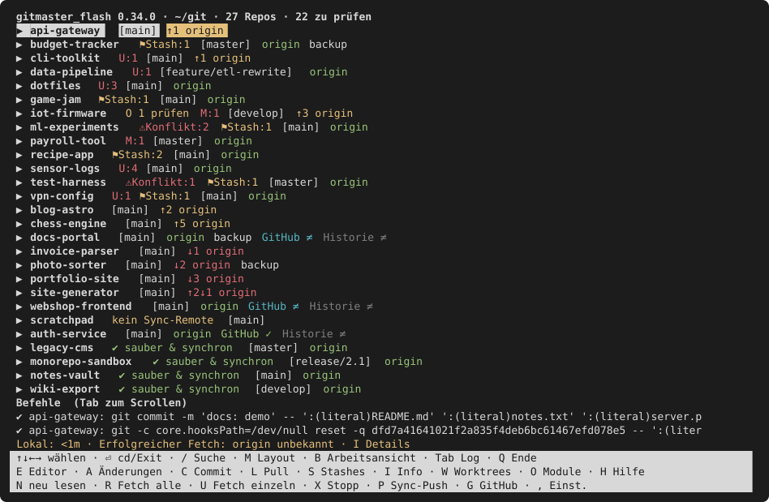
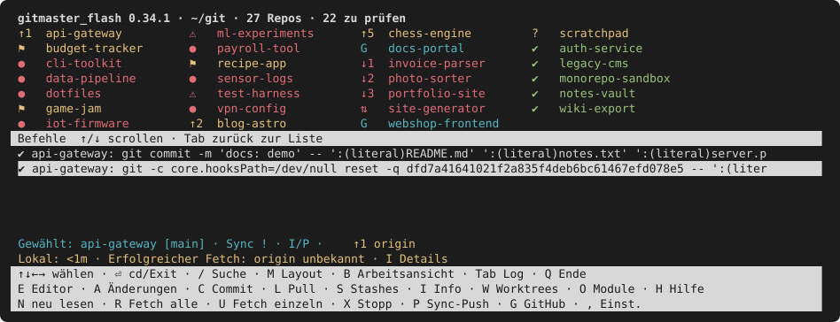
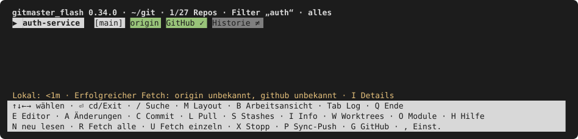

# Interaktive Oberfläche

[English](interface.md) · [Deutsch](interface.de.md) · [Übersicht](../README.de.md)

Die Übersicht enthält die vollständige Tastentabelle.

## Darstellung der Liste (`M`)

Bis 20 Repos startet gmf in der **Detailansicht**: pro Repo eine volle Zeile mit
Zählern, Branch und Remotes. Darüber wird dieselbe Liste zur langen Scrollstrecke,
deshalb startet dann die **Kompaktansicht** — pro Repo eine Marke und der Name,
spaltenweise gefüllt wie bei `ls`, also über die Breite des Fensters statt über
seine Höhe. Das ist das Bild ganz oben. Die Schwelle steht als `compact_from` in
der `config.json`.

Die Detailansicht bleibt bis einschließlich 20 Repos bewusst Standard: Bei
dieser Größe ist die direkte Anzeige aller Zähler, des Branches und der Remotes
weiterhin die klarste Übersicht. Die Kompaktansicht ersetzt sie nicht, sondern
ist ihre natürliche Weiterentwicklung für eine wachsende Repo-Sammlung. In
wenigen Tastendrücken ist das gesuchte Repo erreicht; `M` zeigt dort anschließend
alle Details.

Die Marke ist der ganze Status, auf ein Feld eingedampft:

| Marke | Bedeutung |
|---|---|
| ✔ | sauber und synchron |
| ● | geänderte, gelöschte oder unversionierte Dateien |
| ⚠ | Merge-Konflikt |
| ↻ | laufender Git-Vorgang (Merge, Rebase, Cherry-Pick, Revert, Sequenz oder Bisect) |
| ⚑ | Stash vorhanden |
| ↑n / ↓n | vor/zurück gegenüber dem Sync-Remote |
| Bn | n weitere lokale Branches brauchen Prüfung |
| ⇅ | divergiert (gleichzeitig vor und zurück) |
| ✘ | Fehler beim Repo-Scan oder letzter Fetch eines Remotes fehlgeschlagen |
| G | private Synchronisation erledigt, GitHub-Veröffentlichung noch offen |
| ? | kein Sync-Remote, kein Remote-Branch oder detached HEAD |

Treffen mehrere Zustände zu, zeigt die Marke den dringendsten: zuerst `✘`, dann
`⚠`, `↻`, `●`, `⚑`, den Abstand zum Sync-Remote, weitere Branches und schließlich `?`. Ein offener
Git-Vorgang braucht auch bei sauberem Arbeitsbaum Aufmerksamkeit. Rot steht für
Fehler, Konflikt, lokale Änderung, fehlende eingehende Commits oder divergente private Synchronisation;
Gelb für Stash, ausgehende Commits oder eine fehlende Sync-Beziehung; das grüne
`✔` bedeutet sauber und synchron. `M` oder `I` zeigt die Details hinter der
verdichteten Marke.

`M` schaltet zwischen kompakt und Detail um und behält das gewählte Repo — man
sucht es also in der breiten Übersicht und arbeitet dann im Detail daran weiter.
`←`/`→` springen eine Spalte weiter, womit 60 Repos in wenigen Tastendrücken
durchquert sind. Aufklappen von Dateien und Stashes bleibt der Detailansicht
vorbehalten.

## Was eine Detailzeile verrät



- **Remote-Namen sind immer sichtbar** — jede Zeile endet mit allen konfigurierten
  Remotes, auch wenn alles synchron ist. Reihenfolge: privater Sync-Remote zuerst,
  sonstige Remotes danach, GitHub ganz rechts.
- **↑n / ↓n neben einem privaten Remote** — Commits vor/zurück gegenüber genau diesem
  Remote für den aktuellen Branch, auf Basis des letzten Fetch. `R` aktualisiert
  bei allen Remotes aller Repos den aktuellen Branch einzeln, ohne einen Working
  Tree zu ändern. Der Netz-Fetch schreibt keinen lokalen Ziel-Ref; anschließend
  aktualisiert gmf nur den passenden Tracking-Ref, ohne symbolische Refs aufzulösen.
  Scheitern mehrere Remotes aus verschiedenen Gründen, behält jedes seine eigene
  Diagnose samt Git-Fehler.
- **M / D / U** — Anzahl geänderter, gelöschter und unversionierter Dateien.
- **⚑Stash:n** — vorhandene Stashes. Die übersieht man sonst gern.
- **⚠conflict:n** — ungemergte Dateien, etwa nach einem `git stash apply`, der
  nicht sauber aufging. Bewusst getrennt von „modified", weil dahinter andere
  Arbeit steckt.
- Warnungen wie „kein Sync-Remote" oder „Branch nicht auf dem Remote".

Repos mit offenen Punkten stehen oben, saubere unten. Beide Ansichten benutzen
dieselbe Reihenfolge, in der Kompaktansicht ist also die linke Spalte die
interessante.

## Befehlsprotokoll, immer sichtbar

Die letzten Befehle stehen unter der Liste: in der Detailansicht drei Zeilen, in
der Kompaktansicht alles, was die Spalten übrig lassen. `Tab` setzt den Fokus
dorthin — in der Detailansicht wächst der Bereich dafür auf ein Drittel des
Fensters. Der Auswahlbalken wandert mit dem Fokus: Solange man im Protokoll ist,
hat die Repo-Liste keinen — so ist immer klar, wem die Pfeiltasten gerade
gehören. `↑`/`↓` gehen durch die Befehle, `Tab` führt zurück zur Liste; beide
Seiten merken sich, wo man war.



Abgebrochene Dialoge erscheinen als `⊘ … (nicht ausgeführt — abgebrochen)`, damit
das Protokoll nie etwas als gelaufen ausweist, das gar nicht lief. Zwei
`fetch`-Zeilen sind ebenfalls kein Fehler: gmf holt einmal vor der Rückfrage und
einmal nach der Bestätigung und handelt nur, wenn sich dazwischen nichts bewegt;
die Fetchs verwenden getrennte Einmal-URL-Aliasse. Siehe [Übertragungsprüfungen](security.de.md).

`H` zeigt dasselbe Protokoll vollständig, über den Sicherheitsregeln. Die reinen
Lesebefehle des Scans stehen bewusst nicht drin — sie würden die interessanten
Zeilen zumüllen. Argumente sind so gequotet, wie eine Shell sie braucht, eine
Zeile lässt sich also direkt übernehmen. Zustandsändernde Aktionen stehen mit
ihren echten, vollständig gebundenen Git-Argumenten im Protokoll; abgebrochene
Bestätigungen bleiben ausdrücklich als nicht ausgeführt markiert.

## Stash-Ansicht (`S`)

Die Stash-Ansicht zeigt **alle Stashes mit ihren Dateinamen**. ↑/↓ wählt,
→ klappt einen Stash oder eine Datei auf, ← klappt zu. Enter oder Leertaste
schaltet einen Abschnitt um. Änderungen stehen direkt unter ihrer Datei; der
gewählte Dateiname bleibt über dem scrollenden Inhalt sichtbar. Unversionierte,
binäre und ausschließlich vorgemerkte Änderungen sind enthalten. Abweichende
vorgemerkte Änderungen bekommen einen eigenen beschrifteten Abschnitt.

- **A — Apply:** gewählten Stash anwenden und behalten.
- **P — Pop:** anwenden und seinen Eintrag erst nach Erfolg löschen.
- **D — Löschen:** gewählten Stash ohne Anwenden entfernen; kein Rückgängig in gmf.
- **\* — einzeln/alle:** Aktionsziel auf alle angezeigten Stashes oder zurück auf
  den gewählten umstellen. Das Ziel steht über der Liste und wird nach einer Aktion zurückgesetzt.

Jede Aktion zeigt die betroffenen Stashes und Dateinamen vorab und verlangt `J ⏎`.
Apply/Pop beginnt mit sauberem Index und Arbeitsbaum ohne laufenden Git-Vorgang.
Es stellt mit `--index` sowohl Dateiinhalte als auch die gespeicherte Vormerkung
wieder her. Bei allen Stashes läuft Apply/Pop **ältester zuerst** und stoppt beim
ersten Fehler oder Konflikt. Vorherige Erfolge bleiben; es gibt kein automatisches
Zurücksetzen. Ein fehlgeschlagenes Anwenden kann Dateien bereits geändert haben,
aber sein Stash bleibt erhalten. Vor dem Fortsetzen Konflikte prüfen. Die Ansicht
liest das Repo nach jedem Versuch neu ein. Hat ein früherer Stash vorgemerkte
Änderungen wiederhergestellt, stoppt die Sammelaktion zum Schutz dieser Vormerkung
vor dem nächsten Anwenden, selbst bei getrennten Dateien. Diese Änderungen vor
dem Fortsetzen prüfen und committen.

Die Vorschau bindet Apply an die gespeicherte Commit-ID und prüft Ziel und
Stash-Liste vor der Ausführung erneut. Git kann Branch, Index, Arbeitsbaum und
Stash-Nummern nicht atomar gegen andere Programme schützen; während der Aktion
andere Git-Aktionen und Editoren für dieses Repo schließen. Löschen ist endgültig
und hat eine eigene Warnung. Nach unklarem Ergebnis vor einem erneuten Versuch
Dateien und Stash-Liste prüfen.

## Arbeitsansichten (`B`)

`B` grenzt die Liste nach dem anstehenden Arbeitsschritt ein. Die Pfadsuche
mit `/` bleibt unabhängig davon erhalten. `M` wechselt weiterhin nur die
Darstellung zwischen Detail und Kompakt.

| `--view` | Auswahl |
|---|---|
| `all` | alle Repos |
| `changes` | lokale Dateien, Stashes oder laufende Git-Vorgänge |
| `incoming` | bekannte eingehende Commits auf einem Remote |
| `outgoing` | bekannte ausgehende Commits, fehlende Remote-Branches oder nicht abgedeckte lokale Branches |
| `access` | Fetch-/Lesefehler oder belegte unsichere Remote-Konfiguration |
| `publish` | gespeicherter GitHub-Inhalt abweichend oder aktueller Branch dort nicht vorhanden |

Die Ansichten verwenden lokal bekannte Daten und starten keinen Fetch. `R`
und `U` erneuern die Remote-Messung. Die Kopfzeile nennt aktive Ansicht,
Trefferzahl und ausgeblendete Repos mit Handlungsbedarf. Eine leere Ansicht
behauptet keine geprüfte Sauberkeit. Esc hebt zuerst die Pfadsuche, dann eine
aktive Arbeitsansicht auf; erst danach beendet es das Programm.

In der Kompaktansicht zeigt die Kontextzeile das ausgewählte Repo, Branch,
Sync-Zustand, Remotes und passende Aktionskürzel. `Sync ✔` und `G offen` können
gleichzeitig gelten: privat synchronisiert, aber noch nicht auf GitHub.
Das erhält die Marke `G` und zählt als Handlungsbedarf. `I` erklärt beide
Zustände ausführlich. Aktionskürzel ersetzen keine Prüfung oder Freigabe.
Bei weniger als 100 Spalten werden die Tastenhinweise kürzer, unter 65 Spalten
zeigen sie die häufigsten Aktionen und `H` für die vollständige Hilfe.

GitHub-Inhalt und Historie haben getrennte Anzeigen:



`GitHub ✓` ist grün: Die committeten Dateien entsprechen dem zuletzt bekannten
GitHub-Branch. `Historie ≠` ist grau: Die Commits unterscheiden sich, etwa nach
einer zusammengefassten Veröffentlichung. Bei gleichem Inhalt löst dieser
Historienunterschied weder die Veröffentlichungsmarke noch einen höheren
Problemzähler aus und erscheint nicht unter eingehend/ausgehend. Private
Sync-Remotes prüfen weiterhin die Commit-Abstammung. Ihre Synchronisation bleibt
von der Veröffentlichung unabhängig.

`GitHub ≠` bedeutet abweichenden gespeicherten Inhalt mit Prüfbedarf. Aus getrennten
Historien wird dabei keine Richtung „neuer/älter“ abgeleitet. Die Info-Ansicht
behält die Commit-Zahlen und nennt ausdrücklich ausgenommene Pfade. Nach einem
gescheiterten Fetch oder Vergleich erscheint kein grünes GitHub-Häkchen. `R`
oder `U` aktualisiert den Remote-Stand; uncommittete Dateien behalten ihre eigenen
Änderungsanzeigen. Dies vergleicht Quellstände und prüft kein veröffentlichtes
GitHub-Release.
Bei abweichendem Inhalt und divergenten Historien zeigt `publish` das Repo;
die gerichteten Ansichten eingehend/ausgehend raten keine Richtung.

Nicht interaktiv: `gmf --list --view outgoing` oder
`gmf --json --view publish --filter api`. JSON ergänzt `sync_clean` und
`publication_pending` je Repo; die Metadaten `view` nennen ID, Treffer,
Gesamtbestand und ausgeblendeten Handlungsbedarf. Der Exit-Code bezieht sich
weiter auf die sichtbaren Repos. `--diff HOST --view changes` vergleicht jeden
passenden Repo-Pfad auf **beiden** Rechnern, sobald er auf einer Seite zutrifft.
Dadurch wird eine nur hier geänderte Arbeitskopie nicht zu einem falschen
„Repo nur hier“-Befund. Pfadfilter wirken weiterhin auf beiden Seiten.

## Fetch im Hintergrund (`R`)

`R` fragt jedes sichere Remote nach seinem Stand. Über das Netz und über Dutzende
Repos hinweg dauert das Minuten, deshalb läuft es in einem eigenen Thread: Die
Liste bleibt die ganze Zeit bedienbar, jedes Repo wird eingetragen, sobald sein
eigener Fetch fertig ist, und die Kopfzeile zählt mit — `fetche 12/61`.

Während des Laufs bleibt die Reihenfolge bewusst stehen. Würde bei jedem
eintreffenden Ergebnis neu sortiert, sprängen die Zeilen unter dem Cursor weg und
man handelte an einem anderen Repo als gemeint. Sortiert wird einmal am Ende,
zusammen mit den Repos, die zwischenzeitlich dazugekommen oder verschwunden sind.

Wer während des Laufs committet, pusht oder einen Stash ansieht, behält für
dieses Repo den Stand, den er gerade sieht: Das Ergebnis des Scans dazu ist älter
und wird verworfen. Seine Remote-Zahlen können dann bis zum nächsten `R`
hinterherhinken — der umgekehrte Fehler wäre schlimmer, nämlich einen fertigen
Commit wieder als offene Änderung zu zeigen.

`X` stoppt den Hintergrundscan und behält bereits eingetragene Ergebnisse.
Nur seine eigenen Git-Prozessgruppen werden beendet; unabhängige Aktionen
bleiben unberührt. Beenden der Oberfläche stoppt ebenfalls den laufenden Scan.
`N` liest das ausgewählte Repo lokal neu ein, auch während eines Scans. `U`
wählt genau ein Remote zum Fetch aus; ein laufender Gesamtscan muss dafür erst
mit `X` beendet werden. Branch, Index und Arbeitsverzeichnis bleiben beim Fetch
unverändert.

Die Zeile über den Tasten zeigt das Alter der lokalen Messung und des letzten
**belegt erfolgreichen Fetches je Remote für den aktuellen Branch**. `I` zeigt
die ISO-8601-Zeitpunkte. Nach Programmstart ist das Fetch-Alter unbekannt; gmf
rät es nicht aus Git-Dateizeiten. Ein lokaler Refresh erneuert nur die lokale
Messung. Ein fehlgeschlagener Fetch behält die letzte Erfolgszeit samt Fehler.
Branch- oder Remote-Konfigurationswechsel verwerfen übernommene Fetch-Zeiten.
Diese Angaben ersetzen keine unmittelbare Sicherheitsprüfung vor Übertragungen.
JSON enthält `measured_at` je Repo und `fetched_at` je Remote; ein leerer String
bedeutet unbekannt. Zeitunterschiede allein zählen im Rechnervergleich nicht
als Drift. Nicht interaktiv: `gmf --json --fetch-remote origin /path/to/repo`
ruft nur dieses Remote ab; bei einer Scan-Wurzel gilt die Auswahl je Repo,
fehlende Remotes werden ausdrücklich als Fehler gemeldet.

## Repo-Liste filtern (`/`)

Ab einigen hundert Repos ist Tippen schneller als Blättern. `/` öffnet eine
einzeilige Eingabe; die Liste schrumpft auf die Repos, deren **Pfad** den
eingegebenen Text enthält. `Esc` in der Eingabe lässt den bestehenden Filter
stehen, eine leere Eingabe hebt ihn auf, und `Esc` in der Liste hebt einen
aktiven Filter auf, statt das Programm zu beenden.

Mehrere durch Leerzeichen getrennte Begriffe müssen **alle** vorkommen, in
beliebiger Reihenfolge — `arbeit api` findet also auch
`arbeit/kunde/api-server`, ohne dass man den Teil dazwischen kennt.
Groß- und Kleinschreibung spielt keine Rolle, und die Schreibweise eines
Umlauts ebenfalls nicht: macOS liefert Ordnernamen mal in der einen, mal in der
anderen Unicode-Normalform — ein aus dem Finder eingefügter Name findet sein
Repo deshalb genauso wie ein getippter.

Der Filter ist reine Anzeige: Er ändert nichts an einem Repo und liest auch
nichts neu ein, das Aufheben geht deshalb ohne Wartezeit. Er trifft
ausschließlich den Pfad, nie Branch, Remote oder Dateiinhalt — der Pfad ist die
einzige Angabe, die in jeder Ansicht sichtbar ist, und ein Filter auf
Unsichtbares ließe einen rätseln, warum ein Repo fehlt.

Weil gmf für die Übersicht da ist, sagt die Kopfzeile durchgehend, was
ausgeblendet ist:

```text
 gitmaster_flash 0.34.2 · ~/git · 3/61 Repos · Filter „api“ · 2 zu prüfen (+7 ausgeblendet)
```

`3/61` ist der sichtbare Anteil, und `+7 ausgeblendet` zählt die vom Filter
entfernten Repos, die Aufmerksamkeit bräuchten. Ohne diese Zahl könnte ein
Filter still genau die Repos verstecken, wegen derer man gmf gestartet hat.

## Änderungen rein lesend prüfen (`A`)

`→` zeigt, *dass* sich eine Datei geändert hat; `A` zeigt, *was* sich darin
geändert hat. Datei mit `↑`/`↓` (oder `Tab`) wählen, `⏎` drücken — der Diff
öffnet sich im scrollbaren Betrachter, auch für neue Dateien, die `git diff`
sonst ignoriert, und für gelöschte.

```text
 Änderungen · api-gateway
 M  README.md
 M  server.py
 U  notizen.txt
 D  alte-config.yml

 ↑/↓ oder Tab Datei wählen · ⏎ Diff ansehen · Q/Esc zurück
```

Diese Ansicht bleibt bewusst rein lesend: Sie ändert keinen Index-Eintrag —
Modus, Objekt-ID, Stufe und Pfad bleiben, wie sie sind — und keine Datei im
Arbeitsbaum. Eine bytegenaue Ausnahme: `git diff` frischt die im Index
gespeicherten Zeitstempel (den Stat-Cache) auch mit `GIT_OPTIONAL_LOCKS=0` auf,
`.git/index` kann dabei also mit unveränderten Einträgen neu geschrieben werden.
Für ein sicheres Verwerfen oder Entfernen aus der Vormerkung müsste
gmf den geprüften Dateistand atomar gegen jeden Editor und jeden parallelen
Git-Prozess binden. Git bietet diese Garantie für einen Arbeitsbaum-Pfad nicht.
Deshalb bleiben solche Aktionen nach ausdrücklicher Prüfung dem Terminal
vorbehalten, statt ungesehene Arbeit zu riskieren.

## Repo-Info und Remotes (`I`)

`I` öffnet für das ausgewählte Repo eine scrollbare Übersicht. Sie
zeigt Pfad, Branch und vollständigen HEAD, letzten Commit, Größe der Historie,
Upstream-Stand, Arbeitsbaum-Zähler, Stashes, Tags an HEAD und alle Remotes.
Fetch- und Push-Adressen stehen getrennt da, weil Git dafür unterschiedliche
Ziele konfigurieren kann. GitHub-Remotes erhalten zusätzlich eine
zugangsdatenfreie Web-URL `https://github.com/…`, die sich in unterstützenden
Terminals direkt öffnen lässt. Eingebettete URL-Zugangsdaten, Query-Parameter
und Fragmente werden nie angezeigt. Das Öffnen der Ansicht verändert nichts.

Die Remotes sind auswählbar: `↑`/`↓` oder `Tab` setzt den Auswahlbalken auf den
nächsten Remote-Block, `Bild↑`/`Bild↓` scrollt den Text.

**`T` prüft das ausgewählte Remote.** Dazu läuft `git ls-remote`, das nur die
Ref-Liste erfragt — es überträgt keine Objekte und ändert lokal nichts. Die
Antwort trennt die Fälle, die sonst gleich aussehen:

| Ergebnis | Bedeutung |
|---|---|
| existiert und antwortet (n Branches) | Adresse stimmt, Zugriff klappt |
| antwortet, hat aber keine Branches | erreichbar, Repo noch leer |
| Adresse erreichbar, aber dort ist kein Repo | gelöscht, umbenannt oder kein Zugriff |
| Server verlangt einen Login | Credential-Helper oder SSH-Key fehlt |
| aus dieser Sitzung nicht messbar | der Credential-Helper braucht den Login-Schlüsselbund, den nur die GUI-Sitzung öffnet |
| SSH-Hostschlüssel unbekannt oder geändert | einmal im Terminal verbinden und prüfen |
| Hostname nicht auflösbar | kein Netz oder DNS-Problem |
| keine Verbindung zum Host | offline, Firewall oder Server aus |
| Server antwortet mit Fehler | Problem dort, nicht am eigenen Repo |
| keine Antwort in n Sekunden | Netz oder Server zu langsam |

Unterhalb dieser Klartext-Einordnung bewahrt die Info-Ansicht zusätzlich Gits
eigene Fehlermeldung als Beleg auf.

**`X` entfernt das ausgewählte Remote** — die einzige schreibende Aktion dieser
Ansicht, und sie lässt sich nicht rückgängig machen. Die Vorschau unterstützt
nur getrennte Standard-Fetch-Abbildungen; eigene oder geteilte Abbildungen
sperren das Entfernen vor der Bestätigung. `git remote remove` löscht
neben dem Abschnitt in `.git/config` auch alle Remote-Tracking-Branches
`refs/remotes/<name>/*` samt ihren Reflogs, und lokale Branches mit Upstream auf
dieses Remote verlieren die Verknüpfung. Deshalb zeigt gmf vor der Rückfrage eine
Vorschau: die Adressen, die Zahl der betroffenen Tracking-Branches, die lokalen
Branches, die ihren Upstream verlieren, und wie viele Commits dieser
Tracking-Branches in keinem lokalen Branch, Tag oder anderen Remote stehen — die
kennt nach dem Entfernen nur noch Gits Müllsammler. Darunter steht die Warnung,
dass es kein Rückgängig gibt: `git remote add` legt nur die Adresse neu an, die
Refs kommen nur zurück, wenn der Server sie noch hat. Beim Sync-Remote warnt die
Vorschau zusätzlich, dass `P` für dieses Repo danach nicht mehr geht. Bestätigt
wird wie beim GitHub-Push mit `J ⏎`; jede andere Eingabe bricht ab und landet als
`⊘`-Zeile im Befehlsprotokoll. Ändert sich zwischen Vorschau und Ja die Adresse
oder der Bestand der Tracking-Refs (ein Fetch, ein Terminal nebenan), wird nichts
entfernt. Commits, Dateien, lokale Branches und Stashes bleiben unberührt; auf
dem Server ändert sich nichts.

Alles andere in dieser Ansicht bleibt rein lesend. `T` prüft das gewählte Remote
und bewahrt Gits redigierte Antwort als Beleg auf. Lokale Branches erscheinen mit
letztem Commit, Upstream, Vorsprung/Rückstand und Merge-Zustand; gmf löscht aber
keine Branches. Git würde dabei auch ihre Reflogs löschen, und darin kann der
letzte lokale Verweis auf Commits liegen. Das Löschen bleibt deshalb nach Prüfung
dieser Details eine ausdrückliche Terminal-Aufgabe. `S` öffnet die separate
Stash-Ansicht mit Dateivorschauen und bestätigtem Apply, Pop und Löschen.

Die Werte stehen linksbündig in einer Spalte, und identische Fetch-/Push-Adressen
teilen sich eine `Fetch+Push`-Zeile — getrennt erscheinen sie nur, wenn sie
wirklich abweichen (`git remote set-url --push` erlaubt das, gmf sperrt dann
Transfers).

```text
 Repo-Info · api-gateway
Pfad:            ~/projekte/api-gateway
Branch:          main
HEAD:            a1b2c3d (a1b2c3d4e5f6789012345678901234567890abcd)
Letzter Commit:  2026-07-25T10:30:00+02:00 · Beispielautor
  feat: add health endpoint
Historie:        42 Commit(s) · vollständiger Clone
Upstream:        origin/main (0 voraus / 0 zurück)
Arbeitsbaum:     sauber
Stashes:         0
Tags an HEAD:    v1.4.0

Remotes:
  origin [Sync]
    Fetch+Push:   git@example.invalid:team/api-gateway.git
    Branch main:  0 voraus / 0 zurück

  github [GitHub, letzter Fetch fehlgeschlagen]
    Fetch+Push:   https://github.com/example/api-gateway.git
    Web:          https://github.com/example/api-gateway
    Branch main:  2 voraus / 0 zurück

Lokale Branches:
  main [aktuell]
    Commit:       a1b2c3d · 2026-07-25 · feat: add health endpoint
    Upstream:     origin/main (0 voraus / 0 zurück)

  spike-caching [gemergt]
    Commit:       9f8e7d6 · 2026-07-11 · einfacheren Cache-Key probiert
    Upstream:     (keine)
```

Weitere lokale Branches erscheinen auch in der Hauptübersicht: `B2` bedeutet,
dass zwei nicht ausgecheckte Branches Prüfung brauchen. Ihre Info-Blöcke zeigen,
wie viele Commits außerhalb **lokal bekannter, direkter Remote-Tracking-Refs**
liegen. Ein Branch ohne Upstream kann über die Refs eines anderen Remotes vollständig
abgedeckt sein. Das beschreibt gespeicherte Refs, nicht den aktuellen Serverstand.
`R` holt weiterhin nur den ausgecheckten Branch; andere Branches werden dadurch
nicht vollständig aktualisiert. Symbolische Remote-Refs auf lokale Branches zählen
nicht als Abdeckung. Bei flachen Klonen bleibt ein positiver Rest unbekannt, weil
fehlende Historie einen Verbindungsweg verdecken kann. Ein unlesbares oder während
der Messung verändertes Inventar wird ausdrücklich als nicht verfügbar gemeldet.

## Commit-Hilfe (`C`)

```
 Commit-Hilfe · api-gateway — 4/6 gewählt, prüfen, dann ⏎
 M  README.md                                  ✔ committen
 U  notes.txt                                  ✔ committen
 U  server.py                                  ✔ committen
 U  build/out.o                                ✔ committen
 D  old-draft.md                               — gestaget und gelöscht: nichts zu committen
 U  vendor/lib/                                — fremdes Repo: im Terminal erledigen

 ␣ committen an/aus · G Vorschläge · A alle · N keine · ⏎ weiter · Esc abbrechen
```

1. Alle geänderten und neuen Dateien werden gelistet. `␣` wählt sie an oder ab;
   die Hilfe ändert vor dem Commit weder `.gitignore` noch eine andere Datei im
   Arbeitsbaum. `A` wählt alle, `N` keine. Zwei Arten von Einträgen lassen sich
   gar nicht anwählen. Eine Datei, die gestaget und danach gelöscht wurde
   (`git add x && rm x`): Die Hilfe committet die freigegebenen Pfade gegenüber
   `HEAD`, und so ein Pfad steht weder in `HEAD` noch im Arbeitsbaum — es gibt
   nichts zu committen. Und ein Pfad mit `/` am Ende, also ein weiteres
   Git-Repo mitten im Arbeitsbaum: `git add` machte daraus stillschweigend einen
   Submodul-Verweis, und `git commit -- sub/` lehnt es ebenfalls ab. Sichtbar
   bleiben beide, denn beide Unterschiede sind echt; sie sagen es nur, statt den
   ganzen Commit scheitern zu lassen.

   Submodul-Einträge kennzeichnen Gitlink-Verweise. Ein geänderter, initialisierter
   Modul-Checkout lässt sich im Eltern-Commit festhalten; uncommittete Dateien
   darin nicht. Reine Inhaltsänderungen sind mit einem `O`-Detailhinweis gesperrt.
   Konflikte, nicht lesbare und nicht initialisierte Verweise werden nicht als
   gewöhnliche Dateien angeboten. Ein entferntes oder durch eine Datei ersetztes
   Modul bleibt bei belegtem Zustand auswählbar. Andere Pfade können gegenüber
   `HEAD` weiterhin nichts beitragen, etwa ein nur per `git rm --cached`
   entfernter Pfad. Die Hilfe lässt diese weg und erklärt, wenn keine gewählte
   Datei eine Änderung beiträgt.
2. `G` bietet fertige Teilmengen an — denn bei dreißig geänderten Dateien will
   man meist mehrere zusammenhängende Commits statt eines großen. Drei Sichten:
   nach Art der Änderung (geändert / neu / gelöscht), nach oberstem Ordner und
   nach Dateiendung. Ein Vorschlag, der *alle* Dateien enthielte, fällt weg, und
   zwei Sichten auf dieselben Dateien erscheinen nur einmal — so bleibt die Liste
   kurz:

   ```
    Vorschläge — einer davon ersetzt die aktuelle Auswahl

      geänderte Dateien (4)
      Ordner src/ (3)
      Ordner docs/ (2)
   ```

   Ein gewählter Vorschlag *ersetzt* die Auswahl, statt sie zu ergänzen — nach
   zwei Vorschlägen wüsste sonst niemand mehr, was angehakt ist. Eine
   Umbenennung wird nie getrennt: Quelle und Ziel müssen in denselben Commit,
   deshalb zieht ein Vorschlag, der eine Hälfte trifft, die andere mit und sagt
   das mit `+ Rename-Partner`. Vorschläge setzen nur Haken; committet wird erst
   nach der Bestätigung im nächsten Schritt.
3. Vor der Eingabe der Commit-Message zeigt das Tool die letzten Messages des
   Repos als Stil-Vorlage — so viele, wie über der Eingabezeile Platz haben; die
   Eingabezeile bleibt immer sichtbar.
4. Merge-Konflikte sperren die Hilfe vollständig. Der Commit entsteht über einen temporären Index,
   der ausschließlich die freigegebenen Pfade enthält; ein bestehender Benutzer-Index
   samt bewusst gestagter, aber abgewählter Arbeit bleibt erhalten. Für die
   committeten Pfade übernimmt der echte Index den neuen Commit — genau wie bei
   `git commit -- <pfad>`; sonst meldete `git status` sie weiterhin als geändert.
   Push bleibt eine getrennte, bewusste Aktion mit `P`. Nach einem gewöhnlichen
   lokalen Commit nennt die Ergebniszeile
   `git -c core.hooksPath=/dev/null update-ref --no-deref refs/heads/<Branch> <alte-OID> <neue-OID>`
   als Rückgängig-Befehl. Nach dem allerersten Commit verwendet sie
   `git -c core.hooksPath=/dev/null update-ref --no-deref -d refs/heads/<Branch> <neue-OID>`.
   Der `core.hooksPath`-Teil steht dort, weil gmf den Befehl genau so ausführt:
   Ein Rückgängig-Machen darf den `reference-transaction`-Hook des Repos nicht
   starten. Der vollständige Ref bindet
   das Undo auch nach einem Checkout an den freigegebenen Branch; die erwartete
   neue OID verhindert zusätzlich jede Änderung, wenn dieser Branch weitergezogen
   ist. Die committeten Dateien bleiben vorgemerkt und auf der Festplatte. Bei
   detached HEAD ist die Hilfe gesperrt.

## Worktree-Familien und Submodule (`W`, `O`)

`W` gruppiert die gewählte Arbeitskopie mit Registrierungen desselben gemeinsamen
Git-Verwaltungsverzeichnisses. Jede Arbeitskopie bleibt eine eigene Scan-Zeile.
Die Familienansicht nennt Pfade, Branches und vollständige Commit-IDs sowie
detached, unborn, bare, gesperrte, fehlende und zur Bereinigung vorgemerkte
Zustände. Sie verwendet bereits vorhandene lokale Scan-Messungen; registrierte
Pfade außerhalb der Scan-Wurzel bleiben ausdrücklich ungeprüft und erhalten
keinen zusätzlichen Git-Statusscan. Zeiten von Register und Arbeitskopie stehen
getrennt. Die Familienidentität gilt nur auf diesem Rechner.

`O` trennt je direktem Submodul drei Verweise: Eltern-HEAD, Eltern-Index und
Modul-Checkout. Geänderte Dateien, laufende Vorgänge und konfliktbehaftete
Index-Stufen stehen daneben. Nicht initialisierte, fehlende und ersetzte Module
bleiben sichtbar. Ignore-Einstellungen des Repos verbergen keinen Modul-Inhalt.
Die Ansicht initialisiert, aktualisiert und fetcht kein Modul und führt keinen
konfigurierten Modul-Update-Befehl aus. Verschachtelte Submodule werden nicht
rekursiv inventarisiert.

Beide Aktionen lesen das gewählte Repo lokal neu. `A` und die aufgeklappte Liste
kennzeichnen Modul-Pfade; `C` speichert nur einen freigegebenen Modul-Verweis.
Dateien im Modul zuerst dort committen. Ein Modul-Vorgang ohne Dateiänderungen
erhält eine `O<n>`-Prüfmarke. Nicht lesbare Inventare gelten als nicht verfügbar,
nicht als leer. `--list`, `--json`, Arbeitsansichten und Vergleiche erhalten diese
Unterscheidungen. Absolute Worktree-Pfade und Familien-IDs werden nicht zwischen
Rechnern verglichen; Unterschiede von Modul-Verweis/Inhalt sind lokale Befunde.
Alte Snapshots ohne Modul-Inventar belegen nicht die Abwesenheit von Modulen.

In `gmf --demo` zeigen `W` auf `monorepo-sandbox` und `O` auf `iot-firmware`
beide Beispiele; ihr Aufbau nutzt nur lokale Repos. Die lokale Messzeit steht
vor einem späteren Fetch fest, damit ein langsamer Fetch alten Dateistatus nicht
frisch aussehen lässt. NUL-getrennte Git-Pfade behalten CR, LF und nicht
dekodierbare Bytes intern; die Anzeige maskiert sie.
