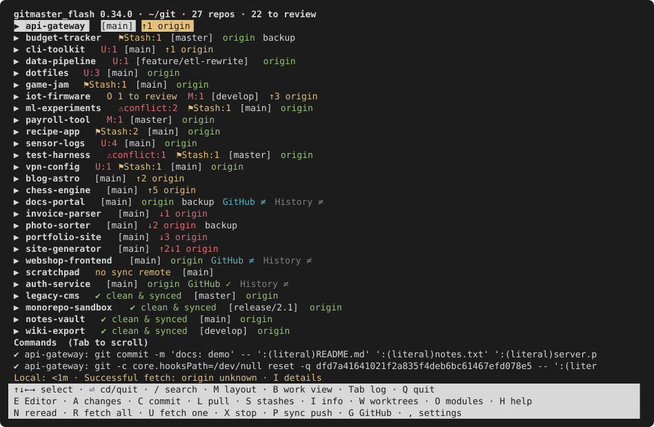
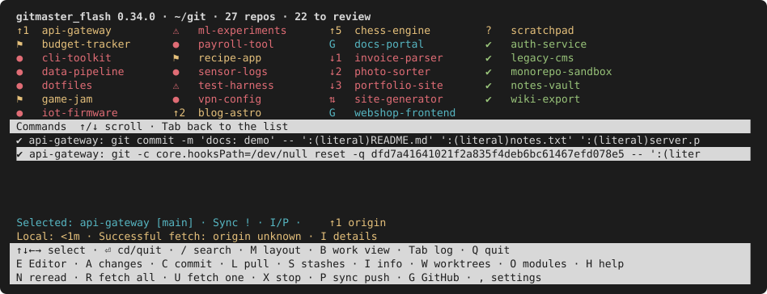
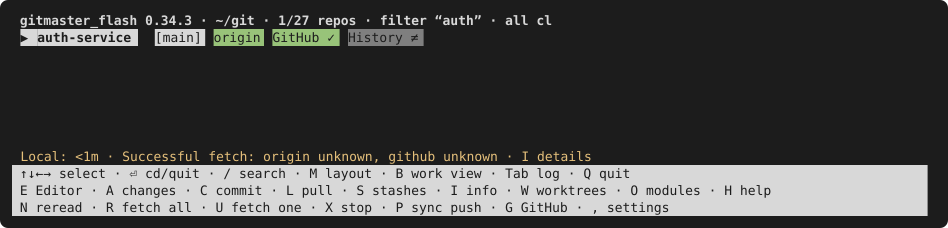

# Interactive interface

[English](interface.md) · [Deutsch](interface.de.md) · [Overview](../README.md)

See the overview for the complete key table.

## List layouts (`M`)

With up to 20 repositories gmf opens in the **detail view**: one full line each,
with counts, branch and remotes. Above that the same list turns into a long
scroll, so it starts in the **compact view** instead — one mark plus the name per
repository, filled column by column like `ls`, using the width of the window
rather than its height. That is the screen at the top of this page; the threshold
is `compact_from` in `config.json`.

The detail view deliberately remains the default for 20 repositories or fewer:
at that size, having every count, branch and remote directly on screen is still
the clearest overview. The compact view is its natural evolution as the
collection grows, not a replacement. It gets you to a repository in a few
keystrokes; press `M` there to see all of that repository's details.

The mark is the whole status, condensed into one field:

| Mark | Meaning |
|---|---|
| ✔ | clean and in sync |
| ● | modified, deleted or untracked files |
| ⚠ | merge conflict |
| ↻ | Git operation in progress (merge, rebase, cherry-pick, revert, sequence or bisect) |
| ⚑ | stash present |
| ↑n / ↓n | ahead of / behind the sync remote |
| Bn | n other local branches need review |
| ⇅ | diverged (both ahead and behind) |
| ✘ | repository scan error or last fetch failed for a remote |
| G | privately synced, with GitHub publication still outstanding |
| ? | no sync remote, no remote branch, or detached HEAD |

When several states apply, the mark shows the most urgent one: `✘`, then `⚠`,
`↻`, `●`, `⚑`, the sync distance, other branches, and finally `?`. A pending Git operation needs
attention even when its working tree is clean. Red means an error, conflict,
local change, missing incoming commits or divergent private synchronization; yellow marks a stash,
outgoing commits or missing sync relationship; green `✔` means clean and
synchronized. `M` or `I` reveals the details behind the condensed mark.

`M` switches between compact and detail view and keeps the selected repository,
so you can find a repository in the wide overview and then work on it in detail.
`←`/`→` move one column at a time, which crosses 60 repositories in a few
keystrokes. Expanding files and stashes stays in the detail view.

## What a detail line tells you



- **remote names are always visible** — every line ends with all configured
  remotes, even when everything is synchronized. Their order is the private sync
  remote first, other remotes next, and GitHub at the far right.
- **↑n / ↓n next to a private remote** — commits ahead of / behind that exact remote for
  the current branch, based on the last fetch. `R` refreshes every remote in every
  repository by fetching the current branch from each remote separately, without
  changing a working tree. The network fetch writes no local target ref; gmf then
  updates only the matching tracking ref without dereferencing symbolic refs. If several
  remotes fail for different reasons, each keeps its own diagnosis and Git error.
- **M / D / U** — number of modified, deleted and untracked files.
- **⚑Stash:n** — stashes that exist in the repo (easy to forget, so it is shown).
- **⚠conflict:n** — unmerged files, e.g. after a `git stash apply` that did not
  apply cleanly. Kept separate from "modified", because it needs different work.
- Warnings such as "no sync remote" or "branch not on remote".

Repositories that need attention sort to the top, clean ones to the bottom. Both
views use that same order, so in the compact view the leftmost column is the one
worth reading.

## Command log, always visible

The last commands stay below the list: three lines in the detail view, and in the
compact view everything the columns leave over. `Tab` moves the focus there — in
the detail view the pane grows to a third of the window for it. The selection bar
moves with the focus: while you are in the log, the repository list has none, so
it is always obvious which pane the arrow keys belong to. `↑`/`↓` walk through the
commands, `Tab` returns to the list — both sides remember where you were.



Cancelled dialogs appear as `⊘ … (not run — cancelled)`, so the log never
suggests something ran that did not. Two `fetch` lines are no glitch either:
gmf fetches once before it asks and once after you confirm, and only acts if
nothing moved in between (the fetches use separate one-time URL aliases). See [transfer checks](security.md).

`H` shows the same log in full, above the safety rules. Read-only scan commands
are deliberately left out — they would bury the interesting lines. Arguments are
quoted the way a shell needs them, so every recorded line can be typed or pasted
as-is. State-changing actions are recorded with their real, fully pinned Git
arguments; cancelled confirmations remain explicitly marked as not run.

## Stash browser (`S`)

The stash view lists **all stashes with their filenames**. Use ↑/↓ to select,
→ to expand a stash or file, and ← to collapse it. Enter or Space toggles a
section. Changes appear directly below their file; the selected filename stays
above the scrolling content. Untracked, binary and staged-only changes are
included. Differing staged changes have their own labelled section.

- **A — Apply:** apply the selected stash and keep it.
- **P — Pop:** apply it, then delete its entry only after success.
- **D — Delete:** remove the selected stash without applying it; no undo in gmf.
- **\* — selected/all:** switch the action scope to all displayed stashes or back
  to the selected one. The scope is shown above the list and resets after an action.

Each action previews the affected stashes and filenames and requires `Y ⏎`.
Apply/pop starts with a clean index and working tree and no ongoing Git operation.
It uses `--index` to restore both file contents and saved staging.
For all stashes, apply/pop runs **oldest first**, stopping at the first error or
conflict. Earlier successes remain; no automatic rollback runs. A failed apply
can already have changed files, but its stash is kept. Check conflicts before
continuing. If an earlier stash restored staged changes, the batch stops before the next
apply to protect that staging, even for separate files; review and commit those
changes before continuing. The view refreshes the repository after every attempt.

The preview binds apply to the saved commit ID and rechecks the target and stash
list before execution. Git cannot atomically protect the branch, index, working
tree or stash numbering against other programs; close other Git operations and
editors for this repo during the action. Deletion is permanent and has a separate
warning. After an uncertain result, inspect files and the stash list before retrying.

## Work views (`B`)

`B` narrows the list by the work ahead. Path search with `/` stays independent.
`M` still changes only the detail/compact layout.

| `--view` | Selection |
|---|---|
| `all` | every repo |
| `changes` | local files, stashes or active Git operations |
| `incoming` | known incoming commits on any remote |
| `outgoing` | known outgoing commits, missing remote branches or uncovered local branches |
| `access` | fetch/read failures or proven unsafe remote configuration |
| `publish` | committed GitHub content differs, or the current branch is missing there |

Views use locally known data and do not start a fetch. `R` and `U` renew remote
measurements. The header names the active view, match count and hidden repos
needing attention. An empty view does not claim a clean inventory. Esc clears
path search first, then an active work view, and only then quits.

In compact layout a context line shows the selected repo, branch, sync state,
remotes and relevant action keys. `Sync ✔` and `G pending` can coexist: privately
synced, with publication to GitHub still outstanding. That receives the `G` mark
and counts as needing attention. `I` explains both states in full. Action keys
never replace a safety check or confirmation. Key hints become shorter below
100 columns; below 65 columns they show common actions and `H` for full help.

GitHub content and history have separate indicators:



`GitHub ✓` is green: the committed files match the last known GitHub branch.
`History ≠` is gray: the commits differ, for example after publishing a squashed
snapshot. With matching content, that history difference does not trigger the
publication mark, raise the review count or enter the incoming/outgoing views.
Private sync remotes still use commit ancestry. Their synchronization
requirements remain independent of publication.

`GitHub ≠` means the committed content differs and needs review. It does not
infer which side is newer from unrelated histories. The info view retains the
commit counts and lists explicitly excluded paths. A failed fetch or comparison
never displays a green GitHub check. `R` or `U` refreshes the remote state;
uncommitted files keep their own change indicators. This is a source comparison,
not a check for a published GitHub Release.
With differing content and divergent histories, `publish` shows the repository;
the directional incoming/outgoing views do not guess a direction.

Non-interactively: `gmf --list --view outgoing` or
`gmf --json --view publish --filter api`. JSON adds `sync_clean` and
`publication_pending` per repo; `view` metadata gives its ID, matches, inventory
total and hidden attention count. Exit status still concerns visible repos.
`--diff HOST --view changes` compares each matching repo path on **both**
machines when either side matches. A working copy changed only here therefore
does not become a false “repo only here” finding. Path filters still apply to
both sides.

## Fetching in the background (`R`)

`R` asks every safe remote for its state. Over the network and across dozens of
repositories that takes minutes, so it runs in a worker thread: the list stays
usable the whole time, every repository is entered as soon as its own fetch is
done, and the header counts along — `fetching 12/61`.

While the run is going, the order deliberately stays put. Re-sorting on every
incoming result would move rows out from under the cursor, and you would act on
a different repository than the one you meant. Sorting happens once, at the end,
together with repositories that appeared or vanished in the meantime.

If you commit, push or view a stash during the run, that repository keeps the
state you are looking at: the scan's result for it is older and is dropped. Its
remote counters can then lag until the next `R` — the opposite mistake would be
worse, showing a finished commit as an open change again.

`X` stops the background scan and keeps results already entered. It ends only
that scan's Git process groups; independent actions remain untouched. Quitting
also stops the active scan. `N` rereads the selected repo locally, even during
a scan. `U` chooses exactly one remote to fetch; first stop an active full scan
with `X`. Fetch leaves the branch, index and working tree unchanged.

The line above the keys shows the age of the local measurement and the last
**proven successful fetch of each remote for the current branch**. `I` shows
ISO-8601 timestamps. Fetch age starts unknown on launch; gmf does not guess it
from Git file times. A local refresh renews only the local measurement. A failed
fetch keeps the last successful time alongside the failure. Branch or remote
configuration changes discard inherited fetch times. These measurements never
replace immediate safety checks before transfers.
JSON includes `measured_at` per repo and `fetched_at` per remote; an empty string
means unknown. Time differences alone do not count as machine drift.
Non-interactively, `gmf --json --fetch-remote origin /path/to/repo` fetches only
that remote; with a scan root the choice applies to each repo, and missing
remotes are explicitly reported as errors.

## Filtering the repo list (`/`)

Past a few hundred repositories, typing beats scrolling. `/` opens a one-line
prompt; the list shrinks to the repositories whose **path** contains what you
typed. `Esc` in the prompt keeps the current filter, an empty input clears it,
and `Esc` in the list clears an active filter instead of quitting.

Several terms separated by spaces must **all** occur, in any order — so
`work api` also finds `work/customer/api-server` without you knowing the part in
between. Matching ignores case, and it ignores how an accent is stored: macOS
hands out folder names in either Unicode normalisation, so a name pasted from
Finder finds its repository just like one you typed.

The filter is display only: it changes nothing in any repository and does not
re-run the scan, so lifting it is instant. It matches the path alone, never the
branch, remote or file contents — the path is the one thing visible in every
view, and a filter keyed on something invisible would leave you guessing why a
repository is missing.

Because gmf exists to give you the overview, the header keeps saying what is
hidden:

```text
 gitmaster_flash 0.34.3 · ~/git · 3/61 repos · filter “api” · 2 to review (+7 hidden)
```

`3/61` is how much you see, and `+7 hidden` counts the repositories the filter
removed that would need attention. Without that number a filter could quietly
hide exactly the repositories you started gmf for.

## Changes: read-only inspection (`A`)

`→` shows *that* a file changed; `A` shows *what* changed in it. Pick a file with
`↑`/`↓` (or `Tab`), press `⏎`, and its diff opens in the scrollable viewer —
including new files, which `git diff` normally ignores, and deleted ones.

```text
 Changes · api-gateway
 M  README.md
 M  server.py
 U  notes.txt
 D  old-config.yml

 ↑/↓ or Tab select file · ⏎ show diff · Q/Esc back
```

This view is deliberately read-only: it changes no index entry — mode, object ID,
stage and path all stay as they are — and no working-tree file. One byte-level
exception: `git diff` refreshes the index stat cache (the recorded timestamps)
even with `GIT_OPTIONAL_LOCKS=0`, so `.git/index` may be rewritten with unchanged
entries. Discarding or unstaging a file would require an atomic comparison with
every editor and Git process that may change it between preview and mutation.
Git does not provide that guarantee for a working-tree path, so gmf leaves these
actions to an explicitly reviewed terminal command instead of risking unseen data
loss.

## Repository info and remotes (`I`)

`I` opens a scrollable overview for the selected repository. It shows the path,
branch and full HEAD, latest commit, history size, upstream ahead/behind state,
working-tree counts, stashes, tags at HEAD, and every remote.
Fetch and push addresses are listed separately because Git can configure them to
different targets. GitHub remotes additionally get a credential-free
`https://github.com/…` web URL that can be opened directly from supporting
terminals. Embedded URL credentials, query parameters, and fragments are never
displayed. Opening the view changes nothing.

The remotes are selectable: `↑`/`↓` or `Tab` moves the highlight from one remote
block to the next, `PgUp`/`PgDn` scrolls the text.

**`T` tests the selected remote.** It runs `git ls-remote`, which only asks for
the remote's ref list — no objects are transferred and nothing changes locally.
The answer distinguishes the cases that otherwise look identical:

| Result | Meaning |
|---|---|
| exists and answers (n branches) | address correct, access works |
| answers but has no branches | reachable, repository still empty |
| address reachable, but no repository there | deleted, renamed, or no access |
| server wants a login | credential helper or SSH key missing |
| not measurable from this session | the credential helper needs the login keychain, which only the GUI session opens |
| SSH host key unknown or changed | connect once in a terminal and verify it |
| host name does not resolve | no network or DNS problem |
| no connection to the host | offline, firewall, or the server is down |
| server replied with an error | problem on their side, not your repository |
| no answer within n seconds | network or server too slow |

The info view also keeps Git's own error message as evidence, underneath the
plain-language classification.

**`X` removes the selected remote** — the only writing action in this view, and
it cannot be undone. The preview supports separate standard fetch mappings only;
custom or shared mappings block removal before confirmation. Besides the section in `.git/config`, `git remote remove`
deletes every remote-tracking branch `refs/remotes/<name>/*` together with its
reflog, and local branches tracking that remote lose their upstream. So gmf shows
a preview before asking: the addresses, the number of tracking branches
affected, the local branches that lose their upstream, and how many commits on
those tracking branches exist in no local branch, tag or other remote — after
removal only Git's garbage collector still knows them. Below that stands the
warning that there is no undo: `git remote add` only re-creates the address; the
refs come back only if the server still has them. For the sync remote the
preview additionally warns that `P` stops working for this repository. Confirm
with `Y ⏎` as for the GitHub push; anything else cancels and is logged as a `⊘`
line in the command log. If the address or the set of tracking refs changes
between preview and yes (a fetch, a terminal next door), nothing is removed.
Commits, files, local branches and stashes stay untouched; nothing changes on
the server.

Everything else in this view stays read-only. `T` tests the selected remote and
keeps Git's redacted response as evidence. Local branches are listed with their
last commit, upstream, ahead/behind and merge state, but gmf does not delete
branches: Git would also delete their reflogs, which can contain the last local
reference to commits. Deletion remains an explicit terminal task after reviewing
those details. `S` opens the separate stash view with file previews and
confirmed apply, pop and delete actions.

Values line up in one column, and identical fetch/push addresses share a single
`fetch+push` line — they are only listed separately when they really differ
(`git remote set-url --push` allows that, and gmf then blocks transfers).

```text
 Repository info · api-gateway
Path:            ~/projects/api-gateway
Branch:          main
HEAD:            a1b2c3d (a1b2c3d4e5f6789012345678901234567890abcd)
Last commit:     2026-07-25T10:30:00+02:00 · Example Author
  feat: add health endpoint
History:         42 commit(s) · full clone
Upstream:        origin/main (0 ahead / 0 behind)
Working tree:    clean
Stashes:         0
Tags at HEAD:    v1.4.0

Remotes:
  origin [sync]
    fetch+push:   git@example.invalid:team/api-gateway.git
    branch main:  0 ahead / 0 behind

  github [GitHub, last fetch failed]
    fetch+push:   https://github.com/example/api-gateway.git
    web:          https://github.com/example/api-gateway
    branch main:  2 ahead / 0 behind

Local branches:
  main [current]
    commit:       a1b2c3d · 2026-07-25 · feat: add health endpoint
    upstream:     origin/main (0 ahead / 0 behind)

  spike-caching [merged]
    commit:       9f8e7d6 · 2026-07-11 · try a simpler cache key
    upstream:     (none)
```

Other local branches are included in the main overview, too: `B2` means two
non-current branches need review. Their info blocks show how many commits are
outside **locally known, direct remote-tracking refs**. A branch without an
upstream can still be fully covered by another remote's refs. This is a statement
about cached refs, not proof of the current server state. `R` still fetches only
the checked-out branch; it does not refresh every other branch. Symbolic remote
refs pointing at local branches do not count as coverage. In a shallow clone,
a positive remainder is shown as unknown because missing history may hide a path.
An unreadable or concurrently changed inventory is labelled as unavailable.

## Commit helper (`C`)

```
 Commit helper · api-gateway — 4/6 selected, review then ⏎
 M  README.md                                      ✔ commit
 U  notes.txt                                      ✔ commit
 U  server.py                                      ✔ commit
 U  build/out.o                                    ✔ commit
 D  old-draft.md                                   — staged then deleted: nothing to commit
 U  vendor/lib/                                    — foreign repository: use the terminal

 ␣ commit on/off · G suggestions · A all · N none · ⏎ next · Esc cancel
```

1. Every changed and new file is listed. `␣` selects or excludes it; the helper
   never edits `.gitignore` or any other working-tree file before the commit.
   `A` takes all of them, `N` none. Two kinds of entry cannot be selected at all.
   A file you staged and then deleted (`git add x && rm x`): the helper commits
   the approved paths against `HEAD`, and such a path is in neither `HEAD` nor
   the working tree — there is nothing to commit for it. And a path ending in
   `/`, which is another Git repository inside the working tree: `git add` would
   silently turn it into a submodule link, and `git commit -- sub/` refuses it
   too. Both stay visible, because both differences are real; they just say so
   instead of letting the whole commit fail.

   Submodule entries identify Gitlink references. A changed, initialized module
   checkout can be recorded in the parent commit; uncommitted files inside it
   cannot. Content-only entries are disabled with an `O` detail hint. Conflicted,
   unavailable or uninitialized references are not offered as ordinary files.
   A removed module or one replaced by a file remains selectable when its
   state is proven. Other paths may still contribute nothing against `HEAD`,
   such as a path removed only with `git rm --cached`; the helper leaves those
   out and explains when no selected path contributes a change.
2. `G` offers ready-made subsets — because with thirty changed files you usually
   want several coherent commits rather than one large one. Three views:
   by kind of change (changed / new / deleted), by top-level folder, and by file
   extension. A suggestion that would cover *everything* is left out, and two
   views hitting the same files appear only once, so the list stays short:

   ```
    Suggestions — pick one, it replaces the current selection

      changed files (4)
      folder src/ (3)
      folder docs/ (2)
   ```

   Picking one *replaces* the selection instead of adding to it — after two
   suggestions nobody could otherwise say what is still ticked. A rename is never
   split: source and target must go into the same commit, so a suggestion that
   catches one half pulls in the other and says so with `+ rename partner`.
   Suggestions only tick boxes; the commit still needs the confirmation in the
   next step.
3. Before you type the commit message, the repository's recent messages are shown
   as a style reference — as many as fit above the input line, which always stays
   visible.
4. Merge conflicts block the helper completely. The commit is built in a temporary index containing
   only the approved paths; an existing user index, including deliberately staged
   but excluded work, stays intact. For the committed paths the real index adopts
   the new commit, exactly as `git commit -- <path>` does — otherwise `git status`
   would keep reporting them as modified. Push remains a separate, deliberate `P`
   action. After an ordinary local commit, the result line includes
   `git -c core.hooksPath=/dev/null update-ref --no-deref refs/heads/<branch> <old-oid> <new-oid>`
   as the undo command. After the very first commit it uses
   `git -c core.hooksPath=/dev/null update-ref --no-deref -d refs/heads/<branch> <new-oid>`.
   The `core.hooksPath` part is shown because gmf runs it that way: undoing a
   commit must not start the repository's own `reference-transaction` hook. The
   full ref keeps the undo
   bound to the approved branch even after a checkout; the expected new OID also
   prevents changing that branch after it has moved. The committed files stay
   staged and on disk. The helper is blocked on a detached HEAD.

## Worktree families and submodules (`W`, `O`)

`W` groups the selected working copy with registrations sharing its Git common
directory. Each working copy remains a separate row in the scan. The family
view names paths, branches and full commit IDs, plus detached, unborn, bare,
locked, missing and prunable states. It reuses local measurements already in
the scan; registered paths outside the scan root are labelled uninspected and
receive no additional Git status scan. Registry and working-copy times are shown
separately. Family identity is local to this machine.

`O` separates three references for each direct submodule: parent HEAD, parent
index and module checkout. Changed files, active operations and conflicted index
stages are listed separately. Uninitialized, missing and replaced modules stay
visible. Repository ignore settings do not hide module contents. The view does
not initialize, update or fetch a module, and it does not run a configured module
update command. Nested submodules are not recursively inventoried.

Both actions reread the selected repository locally. `A` and the expanded list
label module paths; `C` records an approved module reference only. Commit the
files inside the module first. A module operation without file changes receives
an `O<n>` review mark. Unreadable inventories are shown as unavailable, not as
empty. `--list`, `--json`, work views and comparisons retain these distinctions.
Absolute worktree paths and family IDs are not compared across machines; module
reference/content differences are local findings. Old snapshots without module
inventories cannot establish that modules are absent.

Try `W` on `monorepo-sandbox` and `O` on `iot-firmware` in `gmf --demo`. The
demo builds both examples using local repositories. Local measurement time is
captured before a later fetch, so a slow fetch does not make old file status
look newly measured. NUL-delimited Git paths preserve CR, LF and undecodable
bytes internally; displays escape them.
